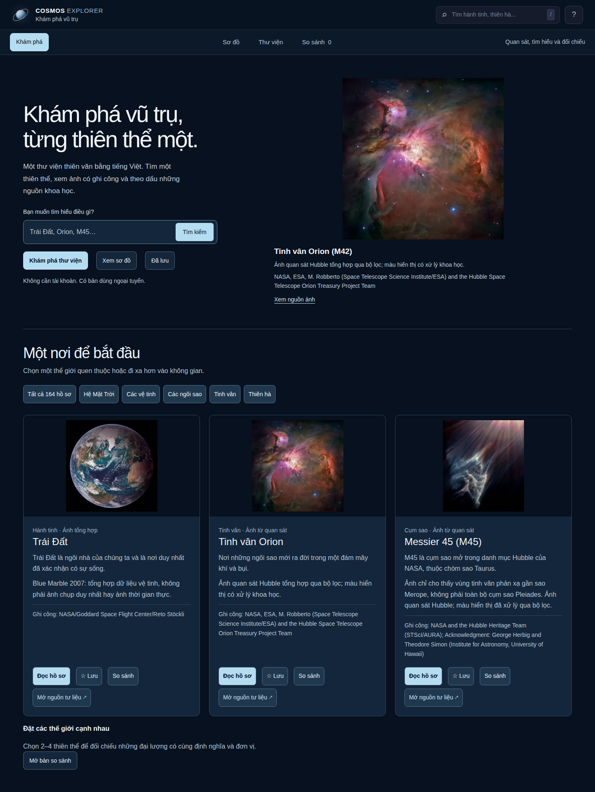
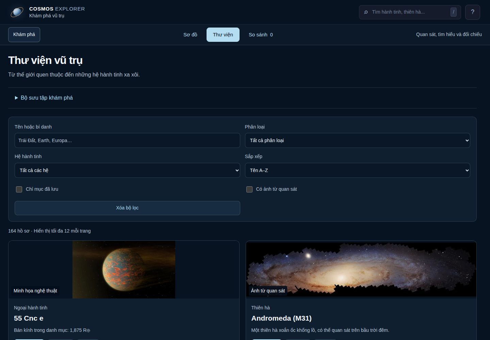
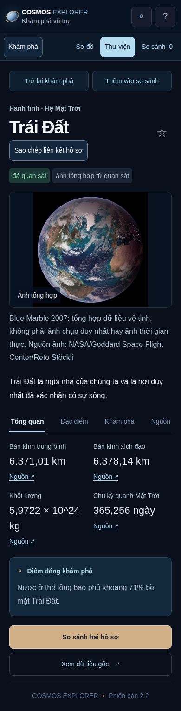

# Cosmos Explorer

**Khám phá thiên văn bằng tiếng Việt — từ Hệ Mặt Trời đến những thiên hà xa.**

Cosmos Explorer là ứng dụng học thiên văn cho học sinh, giáo viên và người yêu vũ trụ. Tìm một thiên thể, đọc hồ sơ có nguồn, xem tư liệu ảnh và đặt các thế giới cạnh nhau để hiểu sự khác biệt. Miễn phí sử dụng, không cần tài khoản.

## Bạn có thể làm gì?

| Trải nghiệm | Điều bạn nhận được |
|---|---|
| Khám phá | 138 hồ sơ trong 11 nhóm, từ hành tinh và vệ tinh đến tinh vân, thiên hà, hố đen |
| Tìm và lọc | Tìm tiếng Việt không dấu hoặc bí danh; lọc loại, hệ, đã lưu và ảnh quan sát |
| Đọc có nguồn | Hồ sơ Tổng quan, Đặc điểm, Khám phá, Nguồn; thông số có đơn vị và tham chiếu |
| So sánh | Chọn 2–4 hồ sơ; chỉ đối chiếu các đại lượng tương thích về định nghĩa và đơn vị |
| Lưu và chia sẻ | Lưu yêu thích trên thiết bị, sao chép liên kết đến đúng hồ sơ |
| Học ngoại tuyến | Mở bản tải về với hình và nội dung cục bộ khi không có mạng |

## Bắt đầu trong một phút

1. [Tải mã nguồn dạng ZIP](https://github.com/nvndy27/Cosmos-Explorer-Demo/archive/refs/heads/main.zip) và giải nén.
2. Mở `cosmos-explorer/index.html` bằng trình duyệt. Không cần cài thư viện hay nhập API key.
3. Vào **Thư viện**, tìm “trai dat”, chọn **Đọc hồ sơ**; mở tab **Nguồn** hoặc thêm Trái Đất và Sao Hỏa vào **So sánh**.

Giáo viên có thể dùng bộ sưu tập Hành tinh đá, Hành tinh khổng lồ, TRAPPIST-1 hoặc Vệ tinh để tổ chức một buổi khám phá. [Hướng dẫn học sinh và giáo viên](docs/USER_GUIDE.md) có kịch bản học 15 phút.

Ảnh chụp từ ứng dụng thật ngày 05/11/2026. Tư liệu thiên văn trong giao diện giữ ghi công của nguồn; [nguồn ảnh và chính sách dữ liệu](docs/DATA_POLICY.md) giải thích quyền và phân loại từng tư liệu.

## Dữ liệu và độ tin cậy

Ứng dụng có 138 hồ sơ và 126 ảnh cục bộ có nguồn, ghi công và checksum. Nội dung được biên tập từ NASA, ESA, JPL, ESO/EHT và các nguồn nghiên cứu được liên kết trong hồ sơ. Đây là dữ liệu tuyển chọn tại thời điểm biên tập, không phải dữ liệu thiên văn thời gian thực.

Sơ đồ Canvas là minh họa khám phá, kích thước và khoảng cách không theo tỷ lệ thực. Ảnh quan sát, tái dựng từ dữ liệu và minh họa nghệ thuật có nhãn riêng. Giá trị thiếu không được thay bằng 0; bán kính trung bình và bán kính quá cảnh không bị gộp để tạo biểu đồ.

## Dữ liệu của bạn

Bản hiện tại không yêu cầu tên, email hoặc mật khẩu. Yêu thích được lưu trong trình duyệt trên thiết bị đang dùng, chưa đồng bộ giữa các máy. Bạn có thể mở **Hướng dẫn (?) → Xóa mục đã lưu trên thiết bị** để xóa yêu thích sau khi xác nhận; hoặc xóa dữ liệu trang trong cài đặt trình duyệt. Khi mở từ file cục bộ, liên kết sao chép chỉ là đường dẫn trên máy bạn; người nhận cần bản tải về tương ứng. Mở nguồn khoa học bên ngoài sẽ đưa bạn đến website của đơn vị cung cấp nguồn.

[Quyền riêng tư và cách xóa dữ liệu](docs/PRIVACY.md) · [Báo cáo vấn đề bảo mật](SECURITY.md)

## Trạng thái phát triển

Bản 2.2 đang chuẩn bị beta. Các kiểm tra Chrome ở 390/820/1440 px, luồng ngoại tuyến, ảnh lỗi, bộ nhớ bị cấm và chia sẻ đã có [bằng chứng kiểm thử](docs/QA.md). Ba phiên người dùng giả lập đã chạy; chưa thay thế thử nghiệm với người thật. Chưa hoàn tất rà khoa học độc lập, screen reader, Firefox/Safari hoặc nghiệm thu hosting công khai.

[Trạng thái chi tiết](docs/STATUS.md) · [Lộ trình sản phẩm](docs/ROADMAP.md) · [Báo lỗi](https://github.com/nvndy27/Cosmos-Explorer-Demo/issues/new?template=bug.md) · [Đóng góp](CONTRIBUTING.md)
