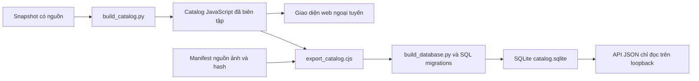
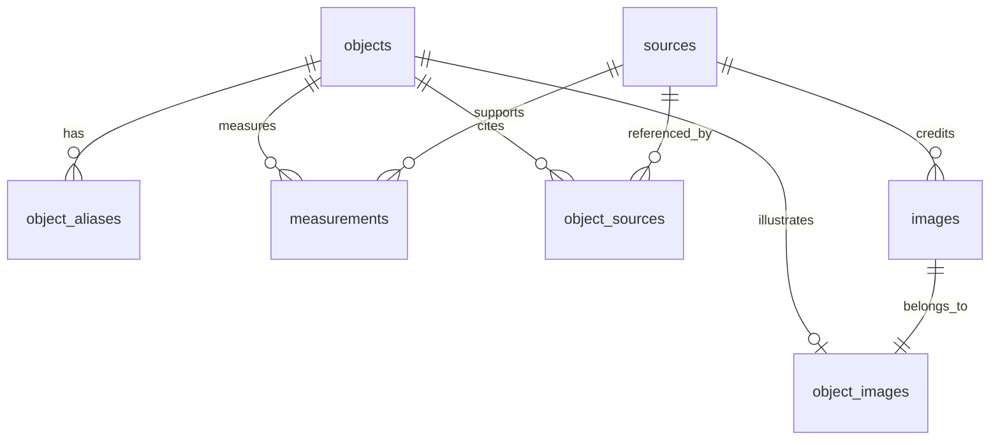

# Cơ sở dữ liệu Cosmos Explorer

SQLite lưu danh mục thiên văn có quan hệ và nguồn gốc dữ liệu. Đây là bản dữ liệu được dựng lại từ catalog biên tập, phục vụ truy vấn và API đọc cục bộ. **Giao diện web hiện vẫn dùng catalog tĩnh, chưa gọi API này.** Vì vậy bản tải về tiếp tục chạy bằng file:// và ngoại tuyến.

## Một nguồn biên tập, hai cách đọc



Không sửa số liệu trực tiếp trong DB để tạo nguồn dữ liệu thứ hai. Sửa snapshot có nguồn theo DATA_POLICY.md, dựng catalog, kiểm tra rồi dựng lại SQLite. Các bản ghi raw_json giữ đầy đủ nội dung gốc; các bảng quan hệ phục vụ lọc và đối chiếu.

## Schema và quan hệ

| Bảng | Vai trò | Số dòng bản hiện tại |
|---|---|---:|
| objects | ID, tên, loại, hệ và bản ghi JSON đầy đủ | 138 |
| object_aliases | Bí danh có thứ tự, FK về objects | 158 |
| sources | URL nguồn không trùng | 334 |
| object_sources | Liên kết hồ sơ–nguồn, vai trò, nhãn, thứ tự | 535 |
| measurements | Khóa đại lượng, số/null, đơn vị, định nghĩa, nguồn và giới hạn | 712 |
| images | Đường dẫn ảnh, nguồn, tác giả, loại tư liệu, ngày lấy, SHA-256 | 126 |
| object_images | Liên kết hồ sơ với tư liệu ảnh | 126 |
| schema_migrations | Lịch sử schema 001–002, cùng PRAGMA user_version | 2 |



Khóa chính, unique, check và khóa ngoại được khai báo trong [SQL migrations](../database/migrations/). Mỗi kết nối bật foreign_keys; API còn bật query_only và mở file bằng mode=ro. Null được giữ là null, không biến thành 0; định nghĩa bán kính và nguồn của từng đại lượng được bảo toàn. Số rất lớn được nhập vào cột REAL theo cách biểu diễn số của catalog JavaScript, còn raw_json giữ bản ghi để round-trip.

## Dựng và kiểm tra

Cần Python 3.12+ với sqlite3 và Node.js 22+. Không cần cài package để dựng DB/API.

```sh
python3 scripts/build_database.py
python3 -m unittest discover -s scripts/tests -p 'test_database.py' -v
```

DB được tạo tại `.automation/catalog.sqlite`, schema version 2. Builder dùng argv với shell=False, SQL tham số hóa, insert theo thứ tự ổn định, kiểm foreign_key_check/integrity_check rồi thay file nguyên tử. Nếu build lỗi, file DB trước đó được giữ nguyên. Kiểm thử xác nhận hai lần dựng cùng dữ liệu cho cùng bytes trong cùng môi trường SQLite; phiên bản SQLite khác có thể tạo định dạng file khác.

Có thể tạo một bản riêng bằng `--output .automation/catalog-backup.sqlite`. Đường dẫn output phải tương đối và nằm trong repo/worktree. DB là artifact có thể dựng lại, không commit binary hoặc journal; schema và nguồn biên tập nằm trong Git. Khi lưu bản DB để kiểm toán, ghi kèm Git revision và môi trường SQLite. Migration mới dùng số liên tiếp; không sửa migration đã phát hành để đổi nghĩa âm thầm.

## Chạy API thật trên máy

```sh
python3 scripts/catalog_api.py --db .automation/catalog.sqlite --host 127.0.0.1 --port 8000
```

| Request | Kết quả |
|---|---|
| GET /api/objects?page=1&page_size=20 | Danh sách có phân trang; page_size từ 1 đến 100 |
| GET /api/objects?q=earth&type=planet | Tìm ID/tên/bí danh/nhãn ngắn, lọc chính xác type runtime |
| GET /api/objects/earth | Bản ghi đầy đủ, nguồn, đại lượng và ảnh |
| HEAD trên các URL trên | Headers của JSON, không body |

API dùng truy vấn cố định và bind tham số; đầu vào không trở thành SQL. Query lặp, tham số lạ, giới hạn không hợp lệ, path traversal và ID sai bị từ chối bằng JSON error. API không phục vụ file tùy ý; HTTP methods ghi bị chặn. Tìm API là substring theo SQLite LIKE, chưa có chuẩn hóa tiếng Việt không dấu như giao diện web.

API chỉ bind địa chỉ IP loopback. Đây là dịch vụ đọc cục bộ, chưa phải backend production: chưa có TLS/reverse proxy, rate limiting hoặc SLA/tải đồng thời. Không mở API ra Internet bằng cách bỏ ràng buộc loopback. Việc đưa lên hosting cần thiết kế và nghiệm thu riêng.

## Dữ liệu người dùng và bảo mật

DB chứa hồ sơ thiên văn và provenance, không có bảng tài khoản, phiên đăng nhập, email hoặc yêu thích. Yêu thích ở localStorage trên từng trình duyệt; người dùng xóa được từ Hướng dẫn. API không lưu request hoặc log query tìm kiếm. Không đưa raw API response vào innerHTML của UI; catalog nội bộ hiện được tin cậy qua quá trình biên tập và review.

Node VM exporter chỉ chạy file catalog nội bộ đã tin cậy, không phải sandbox để chạy mã không tin cậy. DB/API tests kiểm toàn vẹn, FK, round-trip, typed measurements, null, nguồn, ảnh, phân trang, read-only, HTTP methods, SQL injection và traversal. [Python sqlite3](https://docs.python.org/3/library/sqlite3.html) · [SQLite foreign keys](https://www.sqlite.org/foreignkeys.html).
